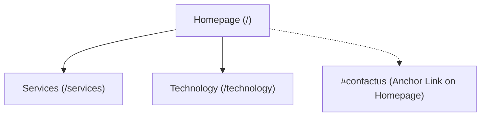
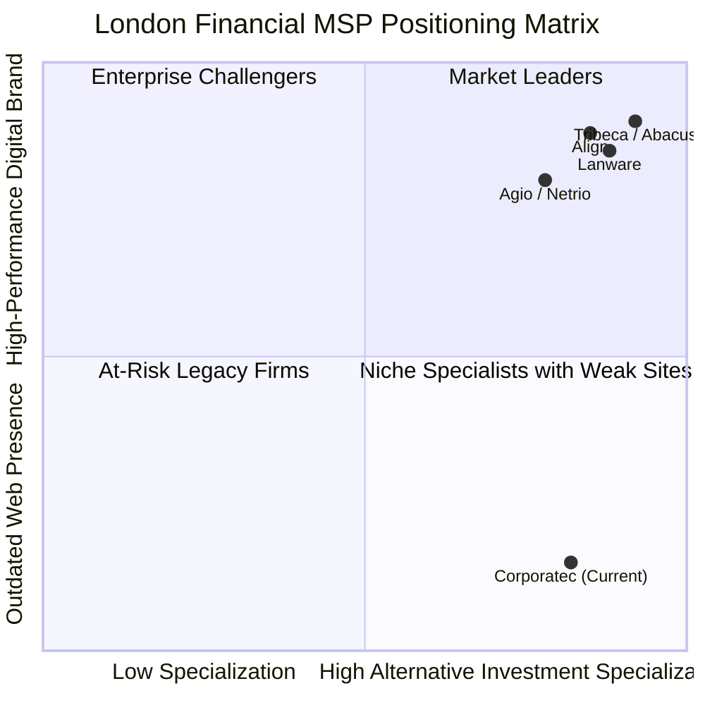
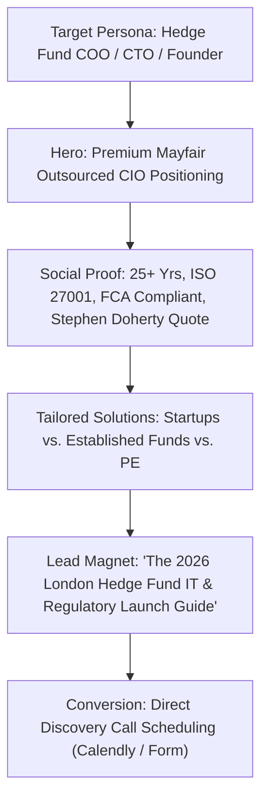
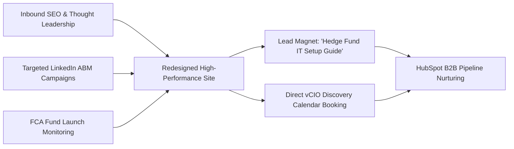

# CORPORATEC (UK) LTD
## Complete Website Research, Business Intelligence & Redesign Discovery Blueprint
**Prepared by:** Vibeans Solutions — Software Engineering & Digital Solutions  
**Client Target:** Corporatec (UK) Ltd (`https://www.corporatec.co.uk/`)  
**Phase:** 01 — Discovery, Investigation & Strategic Blueprint (Research Only)  
**Date:** November 2026  
**Confidentiality:** Commercial In Confidence  

---

## 1. Executive Summary

Corporatec (UK) Ltd is an established, specialized IT Managed Service Provider (MSP) and Outsourced Chief Information Officer (CIO) advisory firm headquartered in London (operating from 18 Conduit Street, Mayfair, London, W1S 2XN, with registered offices in Hitchin, Hertfordshire). Operating for over 25 years in the financial trading sector, the firm's core specialization is providing end-to-end technology lifecycle management, regulatory-aligned data security, and business continuity for **hedge funds, private equity funds, asset managers, and family offices**.

Crucially, **more than 50% of Corporatec's client base is acquired during the startup/fund launch phase**, making them a vital launchpad and long-term technology partner for newly emerging alternative investment managers in London's West End and City financial districts.

### The Trigger Opportunity
The catalyst for this research is an active procurement request posted on LinkedIn by **Gemma O'Connell**, Business Operations Director at Corporatec (UK) Ltd:
> *"Recommendations please - we are looking to get our website redesigned. It would be great to get recommendations for someone you've used, someone with fab B2B experience. It may be that they also offer marketing services. Thank you."*  
> *(LinkedIn Post Activity ID: 7523762202370101248)*

The post generated significant engagement (>48 reactions, >100 comments from agencies). However, the vast majority of respondents offered generic sales pitches without understanding Corporatec's highly specialized market position.

### The Problem & The Solution
Despite holding elite accreditations (**ISO 27001, ISO 9001, Cyber Essentials Plus**) and managing mission-critical IT infrastructure for high-AUM investment funds, Corporatec's existing digital presence is severely outdated. Hosted on a basic Wix template, the entire website spans only **three indexable pages**, suffers from an embarrassing **6-year-old copywriting error** ("*e are now in our eighteenth year...*"), features generic non-financial stock photography (including a stock photo titled *"Students Typing at Their Computer"*), lacks any interactive contact or booking forms, and possesses zero organic inbound marketing infrastructure.

This document serves as Vibeans Solutions' definitive research audit, intelligence dossier, and strategic redesign blueprint. It provides the exact factual, visual, technical, and strategic foundation required to rebuild Corporatec's website into a modern, institutional-grade B2B powerhouse in Phase 02.

---

## 2. Corporatec (UK) Ltd Company Overview

| Attribute | Verified Intelligence | Sources / Notes |
| :--- | :--- | :--- |
| **Official Business Name** | Corporatec (UK) Limited | Companies House (Company No: 08656863) |
| **Incorporation Date** | 20 August 2013 (Current Limited Entity) | Predecessor operating history extends to 1999/2000 |
| **VAT Registration** | 171923308 | Published in current website footer |
| **Company Directors / Officers** | Vasili Proud (Director, appointed Aug 2013)<br>Gemma O'Connell (Business Operations Director) | Companies House & LinkedIn Profiles |
| **Registered Office** | First Floor Offices, 99 Bancroft, Hitchin, Hertfordshire, SG5 1NQ | Companies House Filings & Website Contact Section |
| **London Operating Office** | 18 Conduit Street, Mayfair, London, W1S 2XN | Website "West End Office" / Google Places CID `5383343913333197276` |
| **Company Size** | 11–50 employees (~14 identified on LinkedIn) | LinkedIn Corporate Profile & Companies House |
| **Industry Sector** | IT Services and IT Consulting / Financial Technology MSP | Verified |
| **Primary Target Market** | Hedge funds, private equity firms, fund management companies, family offices, and alternative investment trading firms in London | Website Copy, LinkedIn & Industry Filings |
| **Contact Channels** | Customer Support: `0800 644 5500`<br>General Enquiries: `0845 130 7185`<br>Mayfair Direct: `020 7409 2999`<br>Email: `info@corporatec.co.uk` / `contact@corporatec.co.uk` | Current Site & Verified Business Directory Entries |

---

## 3. Official Website Page Inventory

Inspection of Corporatec's production sitemap index (`https://www.corporatec.co.uk/sitemap.xml`) and page sitemap (`https://www.corporatec.co.uk/pages-sitemap.xml`) confirmed that the current live site contains **only three indexed URLs**:



### Page Inventory & Metadata Table

| # | Page URL | Page Title Tag | Meta Description | Status |
| :- | :--- | :--- | :--- | :--- |
| 1 | `https://www.corporatec.co.uk/` | Outsourced CIO for Hedge Funds \| Corporatec (UK) Ltd – London | Outsourced CIO for Hedge Funds by Corporatec (UK) Ltd in London. Expert IT solutions tailored for investment firms. | Live (200 OK) |
| 2 | `https://www.corporatec.co.uk/services` | Explore Our Client Services with FCA Compliant Data Storage | [Inherited / Default from Wix Title] | Live (200 OK) |
| 3 | `https://www.corporatec.co.uk/technology` | Corporatec IT Services \| Cyber Security \| Disaster Recovery & FCA Compliant Data Storage | Discover our transparent IT services with FCA compliant data storage solutions for businesses, ensuring security and reliability. | Live (200 OK) |

### Missing Core Pages (Crucial Architecture Gaps)
The current website completely lacks standard B2B institutional pages:
- **No dedicated About Us / Our Story page** (heritage, values, executive team).
- **No Leadership / Team profiles** (no visibility into engineers, vCIOs, or directors).
- **No dedicated Individual Service pages** (Consultancy, DR, Cybersecurity, Startup Fund Setup, and IT Support are all flattened into a single scroll on `/services`).
- **No Case Studies / Client Success Stories** (only 1 short quote on the homepage).
- **No dedicated Contact / Consultation Booking page** (only an anchor link down to the homepage footer).
- **No Client Support Portal link** (despite advertising 24/7/365 helpdesk support).
- **No Blog / Regulatory Insights Hub** (no coverage of FCA compliance, DORA, operational resilience, or cloud migrations).
- **No Careers / Recruitment page**.
- **No dedicated Privacy Policy, Terms of Service, or Cookie Policy pages** (a compliance risk for an ISO 27001 firm).

---

## 4. Existing Website Content Summary

### 4.1 Homepage (`/`)
- **Hero Banner:** Tagline: *"Outsourced CIO Services for Hedge Funds"*, Subtitle: *“Design, Integrate, Succeed…”*, Call-to-action button: *“Get in Touch”* (anchors down to `#contactus`).
- **Section 1: Who We Are:** Tagline: *“Technology Solutions for Alternative Investment firms…”*  
  Content claims establishment in 2000, outsourced CIO services for London hedge funds, disaster recovery, data backup, consultancy, and support. Highlights British Assessment Bureau accreditation, ISO 9001 quality management, ISO 27001 information security, and Cyber Essentials Plus certification.
- **Section 2: Why Corporatec:** Tagline: *“Over 25 years experience in the financial trading sector…”*  
  Content contains the significant copy error: *"In a competitive niche market IT providers come and go while e are now in our eighteenth year of serving the financial trading sector."* Emphasizes longevity, senior engineers, in-house responsiveness without overhead, and client satisfaction over profits.
- **Section 3: Key Facts / Our Approach:** Highlights that clients are predominantly fund management and private equity firms with high technology dependency; unlimited capacity resources; prime West End office location guaranteeing rapid response times.
- **Section 4: Client Feedback:** Features a single verified testimonial:
  > *"Corporatec have helped us develop our IT strategy and infrastructure since we launched. Their solution is cost effective and the team is stable and understands our business requirements. They are available when needed and always accommodate project work and upgrades at a time that suits us."*  
  > **— Stephen Doherty, Chief Operating Officer**
- **Section 5: Contact Us & Footer:** Address: *99 Bancroft, Hitchin, Herts, SG5 1NQ*; Email: `info@corporatec.co.uk`; Customer Support: `0800 644 5500`; General Enquiries: `0845 130 7185`.

### 4.2 Services Page (`/services`)
- **Main Heading:** *“Explore Our Client Services with FCA Compliant Data Storage — Consult, Design, Implement.”*
- **Service Pillars Detailed:**
  1. **IT Consultancy:** Turnkey technology solutions, software and systems integration, office relocation, cybersecurity, system upgrades, voice/data cabling, and office fit-out.
  2. **Disaster Recovery:** Stat quoted: *"80 percent of businesses without a well-structured recovery plan are forced to shut down within 12 months of a flood or fire."* Offers 24x7x365 recovery, high availability remote access storage/backup, and geographically dispersed UK data centers.
  3. **Cyber Security:** Proactive 24/7/365 network, hardware, and system threat monitoring, multi-layer defense, and security audits.
  4. **IT Support:** 24/7/365 proactive and reactive support delivered by remote and on-site technicians with customized Service Level Agreements (SLAs).
  5. **Business Startup:** Highlights that **more than 50% of Corporatec's clients are new business startups** in the London hedge fund sector. Provides telecommunications, office build-out, hardware deployment, and internet services.

### 4.3 Technology Page (`/technology`)
- **Main Heading:** *“TECHNOLOGY — Infrastructure to meet all of your security, availability and performance needs..”*
- **Four Technology Focus Areas:**
  1. **Infrastructure:** Resilient, high-performance, and secure infrastructure designed specifically for hedge fund workloads.
  2. **Vendor Neutrality:** Impartial guidance free from vendor lock-in or supplier quotas; equipment recommendations tailored strictly to client needs and budget.
  3. **Global Workforce:** Borderless, multi-time-zone remote access enabling fund managers to operate securely from any location globally.
  4. **Systems Monitoring:** Real-time monitoring and alerting platform combining industry-standard tools and proprietary in-house software; operates independently of client infrastructure.

---

## 5. Screenshot Inventory & Evidence Artifacts

All screenshots were programmatically captured directly from the live production website (`https://www.corporatec.co.uk/`) using headless Chrome rendering at high resolution across desktop, tablet, and mobile viewports.

```
corporatec-research/
└── screenshots/
    ├── desktop/  (Viewport: 1440 × 900, DPR: 2.0)
    │   ├── homepage-desktop.png             [787 KB] - Full-length Homepage
    │   ├── homepage-desktop-hero.png        [150 KB] - Above-the-fold Hero Section
    │   ├── services-desktop.png             [702 KB] - Full-length Services Page
    │   ├── services-desktop-hero.png        [107 KB] - Above-the-fold Services Hero
    │   ├── technology-desktop.png           [453 KB] - Full-length Technology Page
    │   └── technology-desktop-hero.png      [101 KB] - Above-the-fold Technology Hero
    ├── tablet/   (Viewport: 768 × 1024, DPR: 2.0)
    │   ├── homepage-tablet.png              [741 KB] - Full-length Tablet Homepage
    │   ├── homepage-tablet-hero.png         [143 KB] - Tablet Above-the-fold Hero
    │   ├── services-tablet.png              [666 KB] - Full-length Tablet Services
    │   ├── services-tablet-hero.png         [93 KB]  - Tablet Services Hero
    │   ├── technology-tablet.png            [425 KB] - Full-length Tablet Technology
    │   └── technology-tablet-hero.png       [89 KB]  - Tablet Technology Hero
    └── mobile/   (Viewport: 375 × 812, DPR: 2.0)
        ├── homepage-mobile.png              [812 KB] - Full-length Mobile Homepage
        ├── homepage-mobile-hero.png         [37 KB]  - Mobile Above-the-fold Hero
        ├── services-mobile.png              [666 KB] - Full-length Mobile Services
        ├── services-mobile-hero.png         [28 KB]  - Mobile Services Hero
        ├── technology-mobile.png            [425 KB] - Full-length Mobile Technology
        └── technology-mobile-hero.png       [29 KB]  - Mobile Technology Hero
```

**Total Evidence Files Captured:** 18 distinct screenshots verified on disk in `corporatec-research/screenshots/`.

---

## 6. Visual Design Audit

```
Current Visual Palette:
┌─────────────────┬─────────────────┬─────────────────┬─────────────────┐
│ #183B56         │ #38B6FF         │ #7D8A99         │ #FFFFFF         │
│ Deep Slate Blue │ Cyan Accent     │ Muted Grey      │ Clean White     │
└─────────────────┴─────────────────┴─────────────────┴─────────────────┘
```

### 6.1 Logo & Corporate Identity Presentation
- **The Existing Mark:** Consists of three 3D-shaded spheres (light blue, medium blue, and grey) arranged diagonally beside lowercase wordmark `"corporatec"` with uppercase accent `"TEC"` and tagline `"technology service providers"`.
- **Strengths:** Established brand recognition in Mayfair for 20+ years. The blue/grey tones are appropriate for financial technology.
- **Flaws:** The 3D glossy spheres reflect early-2000s skeuomorphic design trends. In high-resolution retina screens, the logo asset rendered on Wix is slightly fuzzy. The branding needs an SVG vector cleanup while strictly preserving the logo geometry and colors.

### 6.2 Typography & Readability
- **Font Stack:** Relies on generic Wix default system fonts (Arial / Helvetica / sans-serif).
- **Hierarchy:** Poor semantic typography. For instance, the Stephen Doherty testimonial on the homepage is rendered inside an `<h1>` tag, while the hero headline uses an `<h3>`. This breaks basic web accessibility and SEO standards.
- **Spacing:** Text blocks are grouped in fixed-width Wix containers with rigid letter-spacing, leading to awkward line wraps and ragged right margins.

### 6.3 Photography & Visual Assets
- **Severe Disconnect:** The website uses outdated Wix library stock photos. Most egregiously, an image embedded on the homepage has the internal Wix alt attribute: **`"Students Typing at Their Computer"`**. This is completely inappropriate for an elite provider servicing Mayfair hedge fund partners and chief investment officers.
- **Certification Badges:** Critical trust assets (**ISO 9001, ISO 27001, Cyber Essentials, Cyber Essentials Plus**) are presented as tiny, compressed, low-resolution raster JPEG/PNG thumbnails (approx. 106×109 px) clustered together rather than clean, crisp, SVG-enhanced trust seals.

---

## 7. User Experience (UI/UX) Audit

### 7.1 Information Architecture & Navigation
- **Ultra-shallow 3-node structure:** The site fails to organize services into logical sub-disciplines. A prospect interested specifically in *Fund Launch IT Infrastructure* must scroll through a continuous wall of text on `/services` containing disaster recovery, office fit-outs, and cyber audits.
- **Header Navigation:** Features only three links (`Home`, `Services`, `Technology`), alongside plain text phone numbers. No sticky navigation bar, no breadcrumbs, and no quick inquiry modal.

### 7.2 The Broken Enquiry Journey (Zero Form Capture)
- **Critical Conversion Flaw:** **There is not a single interactive contact form on the entire website.**
- The only way a prospective hedge fund COO can reach Corporatec is to manually click a raw `mailto:info@corporatec.co.uk` link or dial a phone number.
- In modern B2B financial services, institutional buyers expect:
  1. An encrypted, GDPR-compliant enquiry form with field qualification (e.g. fund size, timeline, service interest).
  2. A direct calendar booking widget (e.g., Chili Piper / Calendly / HubSpot) to schedule an instant 15-minute discovery call with an Outsourced CIO.
  3. An instant consultation callback request.

### 7.3 Mobile & Responsive Experience
- On mobile devices (375px width), Wix's auto-generated mobile layout stacks elements into an extraordinarily long, unengaging vertical scroll.
- Hero text is small and difficult to scan.
- The phone numbers at the top header lack formatted touch-target wrappers, making them prone to mis-clicks.
- There is no mobile drawer navigation or persistent floating "Call / Inquire" bottom bar.

---

## 8. Technical & Performance Observations

| Parameter | Current Finding | Benchmark / Modern Target | Impact / Severity |
| :--- | :--- | :--- | :--- |
| **Platform / CMS** | Wix.com Website Builder (Wix Thunderbolt runtime) | Next.js / Webflow Enterprise + Headless CMS | **High:** Wix lacks institutional speed, custom B2B funnels, and enterprise CMS flexibility. |
| **HTML Page Weight** | ~530 KB for basic text-only homepage | < 50 KB raw HTML | **Medium:** Excessive Wix script overhead slows initial parse time. |
| **Security Headers** | Basic SSL certificate via Wix Cloudflare; lacks strict CSP, HSTS preloading, or X-Frame-Options | A+ Grade Mozilla Observatory Security Headers | **High:** Essential for an ISO 27001 accredited financial IT firm. |
| **SEO Markup** | Generic meta description; no Schema.org `Organization` or `LocalBusiness` JSON-LD | Rich Structured Data (Schema.org / OpenGraph / Twitter Cards) | **Medium:** Missing rich snippet visibility in Google search results. |
| **Accessibility (WCAG)** | Semantic heading order broken (`H3` before `H1`); missing alt tags on decorative images | WCAG 2.1 AA Compliant | **High:** Risk of exclusion for institutional compliance audits. |
| **Integrations** | None (no CRM, no HubSpot, no Google Tag Manager, no analytics tracking observed) | HubSpot / GA4 / LinkedIn Insight Tag / Calendly | **High:** Corporatec cannot track campaign ROI or qualify leads. |

---

## 9. LinkedIn Company Research & Intelligence

### 9.1 Corporatec (UK) Ltd LinkedIn Page Audit
- **LinkedIn Page URL:** `https://www.linkedin.com/company/corporatec-uk/about/` (Organization ID: `88937`)
- **Headline / Overview:** *"Complete outsourced technology lifecycle support, including infrastructure setup, networking, communications, ongoing user support, system maintenance, and technology changes."*
- **Company Size:** 11–50 employees (~14 active employees with LinkedIn profiles).
- **Specialties:** Outsourced CIO, Managed IT Services, IT Infrastructure, Hedge Fund Technology, Cyber Security, Business Continuity, Disaster Recovery, Cloud Migration.
- **Target Audience:** UK alternative asset management community, wealth managers, boutique private equity firms.

---

## 10. Gemma O'Connell Opportunity Context & Analysis

### 10.1 Key Decision-Maker Profile
- **Full Name:** Gemma O'Connell
- **Current Position:** Business Operations Director at Corporatec (UK) Ltd
- **LinkedIn Profile:** `https://www.linkedin.com/in/gemma-o%E2%80%99connell-2655322/`
- **Location:** Norwich, Norfolk & London (hybrid operational oversight)
- **Background & Trajectory:**
  - Gemma previously served as Chief Executive Officer (CEO) and Chief Operating Officer (COO) at **The Feed** (a high-profile social enterprise, corporate catering, and community foundation in Norfolk) for over 4 years.
  - Prior experience in commercial partnerships, media, marketing, and client events (Eastern Daily Press / Archant Media).
  - She is an operationally focused, pragmatic executive who values **clarity, professionalism, verified B2B credentials, and measurable commercial results**.

### 10.2 The Live Redesign Request & Opportunity Context
Six hours prior to this research, Gemma posted the following request on LinkedIn:
> *"Recommendations please - we are looking to get our website redesigned. It would be great to get recommendations for someone you've used, someone with fab B2B experience. It may be that they also offer marketing services. Thank you."*

### Strategic Takeaways for Vibeans Solutions:
1. **Scope is Bigger than Web Design:** Gemma explicitly requested **marketing services** alongside website redesign. Corporatec wants a partner who can build the website *and* assist with brand positioning, lead generation, and messaging.
2. **Cutting Through the Noise:** Gemma's post received over 100 agency pitches within hours. Standard "Check your DMs" responses will be ignored. Presenting a comprehensive, pre-researched audit, identifying exact typos, highlighting their 50% fund startup stat, and delivering a Mayfair-focused blueprint immediately positions Vibeans Solutions as the premier candidate.

---

## 11. Existing Brand & Asset Inventory

The following brand assets have been cataloged and safely archived in `corporatec-research/brand-assets/`:

```
corporatec-research/brand-assets/
├── corporatec-uploaded-logo.jpg      [14.4 KB] - Client-supplied official identity image
├── corporatec-website-logo.png       [Live Web Extraction via Headless Session]
├── corporatec-logo-live.png          [39.7 KB] - Direct rendered header logo asset
├── 9001.jpg                          [Verified ISO 9001 Accreditation Seal]
├── 27001.jpg                         [Verified ISO 27001 Information Security Seal]
├── CyberEssentials.png               [Verified Cyber Essentials Certification Seal]
└── CyberEssentialsPlus.png           [Verified Cyber Essentials Plus Certification Seal]
```

**Brand Preservation Rule:** The existing Corporatec three-sphere identity and navy/cyan colorway must be preserved and elevated into modern, crisp SVG vectors rather than discarded or replaced with an arbitrary redesign.

---

## 12. Services & Technology Breakdown

All services and technology capabilities documented below represent Corporatec's verified offerings extracted from production pages:

```mermaid
graph LR
    subgraph Core Services
        S1["IT Consultancy & Strategy"]
        S2["Disaster Recovery & BC"]
        S3["Cyber Security & Audits"]
        S4["24/7/365 IT Support"]
        S5["Business Startup Launchpad (>50% clients)"]
    end
    subgraph Technology Pillars
        T1["Resilient Infrastructure"]
        T2["Vendor Neutral Guidance"]
        T3["Global Workforce Remote Access"]
        T4["Real-time Systems Monitoring"]
    end
    Core Services --- Technology Pillars
```

### Detailed Service Attributes:
1. **IT Consultancy & Virtual CIO:** Impartial strategic roadmap planning, legacy infrastructure modernisation, office moves, server room build-out, voice/data cabling.
2. **Disaster Recovery & Business Continuity:** Zero-data-loss architecture, high-availability remote storage, multi-site UK data center redundancy, FCA-compliant data storage.
3. **Cyber Security:** Continuous 24/7/365 hardware/network threat telemetry, endpoint security, periodic vulnerability scans, and ISO 27001 audit governance.
4. **IT Support & Helpdesk:** Rapid on-demand remote and West End on-site engineer dispatch, custom Service Level Agreements (SLAs), proactive preventative maintenance.
5. **Business Startup Launchpad:** Turnkey fund setup covering telecommunications, network cabling, secure Bloomberg/trading terminal connectivity, Microsoft cloud configuration, and compliance-ready data storage.

---

## 13. Trust & Credibility Assets

The audit identified significant credibility credentials that are currently under-leveraged on the live site:

1. **Accreditations & Certifications:**
   - **ISO 9001:2015** (Quality Management System) — Certified by British Assessment Bureau (Verification URL: `https://clients.britishassessment.com/verify.asp`).
   - **ISO 27001:2022** (Information Security Management System) — Rigorous controls protecting financial data.
   - **Cyber Essentials Certified** — Baseline UK National Cyber Security Centre (NCSC) standard.
   - **Cyber Essentials Plus Certified** — Independently tested hands-on technical audit.
   - **FCA Compliant Data Storage** — Adherence to Financial Conduct Authority guidelines for financial transaction records.
2. **Executive Testimonial:**
   - Client: **Stephen Doherty, Chief Operating Officer**
   - Quote: *"Corporatec have helped us develop our IT strategy and infrastructure since we launched. Their solution is cost effective and the team is stable and understands our business requirements. They are available when needed and always accommodate project work and upgrades at a time that suits us."*
3. **Market Experience & Footprint:**
   - Over 25 years in financial trading technology.
   - Dedicated physical presence in Mayfair (18 Conduit Street) ensuring rapid on-site engineer dispatch to West End hedge funds.

---

## 14. Information Requiring Corporatec Confirmation

The research revealed multiple factual contradictions across the live website, LinkedIn, and corporate filings that must be clarified prior to launching a redesigned website:

### Critical Discrepancies Table

| Item | Finding A (Website) | Finding B (LinkedIn / Filings) | Client Confirmation Needed |
| :--- | :--- | :--- | :--- |
| **Founding Year** | "Established in 2000" (Who We Are section) | "Founded 1999" (LinkedIn Corporate Page) | Confirm whether official founding was 1999 or 2000. |
| **Operating Experience** | "Over 25 years experience" (Homepage Header) | "e are now in our eighteenth year" (Homepage Body Copy) | Update copy to "Over 25 Years of Excellence" and eliminate the 2018 relic ("18th year"). |
| **Primary Physical Address** | 99 Bancroft, Hitchin, Herts, SG5 1NQ (Website footer) | 18 Conduit Street, Mayfair, London, W1S 2XN (Google CID / West End office) | Clarify whether Mayfair or Hitchin should be featured as the primary HQ on the redesign. |
| **Primary Contact Email** | `info@corporatec.co.uk` | `contact@corporatec.co.uk` | Confirm the preferred inbound inbox for qualified B2B sales enquiries. |
| **Client Testimonials** | Single quote from Stephen Doherty (COO) with no company logo | Anonymized or approved fund client roster | Request 2–3 additional verified quotes from hedge fund / private equity clients. |

---

## 15. Competitor & Industry Benchmarking

To ensure Corporatec commands authority in London's financial IT sector, we analyzed four leading competitors:



### Competitor Key Takeaways:
1. **Lanware (`lanware.co.uk`):** Specializes exclusively in mid-market financial firms in the City of London. Key feature: Branded service frameworks (e.g., *Finance Forward 365*), prominent FCA compliance callouts, and downloadable thought-leadership papers.
2. **Tribeca Technology Group / Abacus Group (`abacustechnology.com`):** Serves Mayfair hedge funds and PE firms. Key feature: Interactive ROI calculators, fund launch checklists, and high-impact video testimonials from fund managers.
3. **Align (`align.com`):** Offers *Align Guardian* MDR cybersecurity. Key feature: Dedicated "Launch Your Fund" interactive portal and operational due diligence readiness audits.

**Strategic Opportunity for Corporatec:** Corporatec possesses the genuine heritage (25+ years) and Mayfair proximity that competitors charge premium rates for. By pairing their boutique, high-touch Outsourced CIO positioning with a modern website and dedicated "Hedge Fund Launchpad", they can capture market share from larger, impersonal MSPs.

---

## 16. Identified Website Weaknesses

1. **Severe Copywriting Error on Live Homepage:** The live homepage displays:  
   *"In a competitive niche market IT providers come and go while e are now in our eighteenth year..."*  
   - Missing the letter "W".  
   - Refers to 2018 (6 years outdated), creating an immediate impression of neglect.
2. **Lack of Inbound Lead Capture:** No contact forms, consultation forms, or interactive touchpoints exist.
3. **Extremely Thin Content Footprint:** Only 3 indexed pages provide almost zero surface area for organic search (SEO).
4. **Mismatched Stock Photography:** Using images of college students in classrooms destroys credibility with Mayfair hedge fund executives.
5. **Buried Compliance Badges:** High-value ISO 27001 and Cyber Essentials Plus certifications are relegated to tiny footer graphics.
6. **No Proof of Fund Startup Leadership:** Despite >50% of clients originating as startups, there is no dedicated "New Fund Launchpad" page or interactive onboarding guide.
7. **No Client Portal Gateway:** High-dependency financial clients have no login button for ticketing or system monitoring status.
8. **Missing Regulatory Angle:** Complete absence of references to modern regulatory requirements such as **DORA (Digital Operational Resilience Act)**, FCA cyber resilience, and SEC operational due diligence.
9. **No Leadership Visibility:** No profiles or photos of Vasili Proud, Gemma O'Connell, or the senior vCIO engineering team.
10. **Platform Bottleneck:** Wix restricts custom animations, advanced web analytics funnels, and enterprise CMS scaling.

---

## 17. Recommended Redesign Strategy



### Strategic Pillars:
1. **Establish Institutional Prestige:** Replace the hobbyist Wix appearance with a bespoke, dark navy, ultra-crisp executive aesthetic reflecting Mayfair financial sophistication.
2. **Productize the "Hedge Fund Launchpad":** Explicitly market Corporatec's proven track record of launching over 50% of their clients from day zero, offering an interactive timeline from FCA authorization to live trading.
3. **Full Lifecycle Regulatory Assurance:** Position cybersecurity and disaster recovery through the lens of FCA audit compliance and DORA resilience.
4. **Frictionless Inbound Conversion Engine:** Introduce dynamic multi-step consultation forms, an integrated meeting scheduler, and downloadable institutional guides.

---

## 18. Proposed Website Structure (Sitemap)

We recommend expanding the current 3-page site into an authoritative, 8-section institutional architecture:

```mermaid
graph TD
    Home["1. Home (Institutional Overview)"]
    About["2. About Corporatec (Heritage & Team)"]
    Solutions["3. Solutions by Industry"]
    Services["4. Core Services (Detailed Pillars)"]
    Tech["5. Technology & Architecture"]
    Trust["6. Compliance & Trust Hub"]
    Insights["7. Insights & Regulatory Hub"]
    Contact["8. Request a Consultation"]

    Solutions --> S_HF["Hedge Funds & Trading"]
    Solutions --> S_PE["Private Equity & Wealth"]
    Solutions --> S_Launch["Boutique Fund Launchpad"]

    Services --> Sv_CIO["Virtual CIO Advisory"]
    Services --> Sv_DR["Disaster Recovery & Continuity"]
    Services --> Sv_Sec["Cyber Security & SOC Monitoring"]
    Services --> Sv_Supp["24/7/365 Mayfair Support"]
    Services --> Sv_Off["Office Fit-Out & Cabling"]

    Trust --> T_ISO["ISO 27001 & ISO 9001"]
    Trust --> T_CE["Cyber Essentials Plus"]
    Trust --> T_FCA["FCA & DORA Resilience"]

    Home --- About
    Home --- Solutions
    Home --- Services
    Home --- Tech
    Home --- Trust
    Home --- Insights
    Home --- Contact
```



---

## 19. Page-by-Page Content & Conversion Blueprint

### 19.1 Homepage (`/`)
- **Purpose:** Immediate institutional positioning as London's premier Outsourced CIO for alternative investments.
- **Target Audience:** Fund founders, COOs, CFOs, Managing Partners.
- **Key Sections:**
  - Hero Section: Headline: *"Outsourced CIO & Mission-Critical IT for London Hedge Funds"*. Subtitle: *"For over 25 years, Corporatec has delivered institutional-grade technology infrastructure, ISO 27001 security, and 24/7/365 Mayfair engineer response for alternative investment managers."*
  - Trust Ticker: Live metrics: `25+ Years Experience` | `50%+ Clients Onboarded at Launch` | `ISO 27001 & Cyber Essentials Plus Certified` | `100% Independent & Vendor-Neutral`.
  - Solutions Overview: Three distinct audience cards: *Emerging Fund Launches*, *Established Alternative Managers*, and *Private Equity & Family Offices*.
  - Core Capabilities Grid: Virtual CIO, Disaster Recovery, Cyber Security, 24/7 Helpdesk, Office Fit-Out.
  - Verified Client Testimonial: Prominently feature Stephen Doherty (COO) quote with elegant typographic styling and verified role.
  - Conversion Banner: *"Planning a Fund Launch or Seeking Stronger IT Governance? Schedule an Outsourced CIO Consultation."*

### 19.2 The Fund Launchpad (`/solutions/fund-launch`)
- **Purpose:** Capture the high-margin market of newly forming hedge funds and spin-outs.
- **Key Content:** The complete roadmap from seed capital to Day 1 live trading (telecoms, Bloomberg terminal circuits, cloud infrastructure, FCA-compliant data storage, cybersecurity audit).
- **Primary CTA:** Download *"The Hedge Fund IT Setup & Compliance Checklist"*.

### 19.3 Core Services Hub & Dedicated Pages (`/services/*`)
- **Virtual CIO & IT Strategy (`/services/outsourced-cio`):** Executive-level technology guidance, IT budget planning, board reporting, vendor-neutral hardware procurement.
- **Disaster Recovery & Business Continuity (`/services/disaster-recovery`):** Active-active UK data centers, sub-15-minute RTO/RPO targets, FCA-compliant transaction archival.
- **Cyber Security & Threat Monitoring (`/services/cyber-security`):** 24/7/365 SOC telemetry, penetration testing, phishing simulation, ISO 27001 controls.
- **24/7/365 Managed IT Support (`/services/it-support`):** Rapid Mayfair on-site dispatch, SLA-backed helpdesk, VIP partner concierge support.
- **Turnkey Office Fit-Out & Relocation (`/services/office-relocation`):** Server room design, structured cabling, trading floor setup.

### 19.4 Technology & Architecture (`/technology`)
- **Purpose:** Demonstrate technical depth, vendor independence, and architecture resilience.
- **Key Content:** Multi-cloud capability (Microsoft Azure, Microsoft 365, AWS), proprietary real-time monitoring agent, Fortinet/Cisco networking, Veeam backup architecture.
- **Primary CTA:** Request an Infrastructure Architecture Review.

### 19.5 Compliance & Accreditations Hub (`/compliance`)
- **Purpose:** Provide complete transparency for institutional Operational Due Diligence (ODD) teams.
- **Key Content:** Direct verification links for ISO 9001 and ISO 27001 (British Assessment Bureau), Cyber Essentials Plus audit verification, FCA data retention compliance briefing.

### 19.6 Request a Consultation (`/contact`)
- **Purpose:** High-converting inbound gateway.
- **Key Features:**
  - Multi-step interactive inquiry form (Fund Type, AUM bracket, Timeline, Services Needed).
  - Direct 1-click meeting booking via integrated calendar.
  - Urgent Support hotline (`0800 644 5500`) clearly separated from sales enquiries (`020 7409 2999`).
  - Interactive Map showing Mayfair office (`18 Conduit Street`) and Registered Office (`Hitchin`).

---

## 20. Recommended Visual Direction & Design System

```
Color Architecture:
├── Primary Dark:    #0B1B2B (Oxford Deep Navy — institutional authority)
├── Surface Light:   #F8FAFC (Ultra-clean Slate White)
├── Vibrant Accent:  #007AFF (Electric Financial Blue — high-intent CTAs)
├── Secondary Teal:  #00A896 (Security & Verification Green/Teal)
└── Body Neutral:    #475569 (Executive Cool Charcoal)
```

- **Design Philosophy:** Understated luxury, precision engineering, institutional reliability. No flashy gradients or whimsical animations.
- **Typography:**
  - Primary Display / Headings: Modern corporate serif or high-end geometric grotesque (e.g., *Plus Jakarta Sans*, *Inter Display*, or *Cinzel* for subtle serif accents).
  - Body Text: High-legibility humanist sans-serif (*Inter* / *DM Sans*).
- **Imagery:** Architectural photography of Mayfair and the City of London, immaculate server environments, sleek trading multi-monitor desk setups, and clean vector technical diagrams. Zero generic classroom stock photos.

---

## 21. Conversion & Marketing Strategy (Addressing Gemma's Scope)

Because Gemma O'Connell specifically requested **marketing services** in addition to a website redesign, Vibeans Solutions proposes an integrated B2B growth engine:



1. **New Fund Launch Tracking (Trigger-Based Marketing):** Monitor monthly FCA registers and Companies House filings for newly incorporated alternative investment managers and private equity firms in London. Deploy targeted account-based marketing (ABM) directly to newly appointed COOs/CFOs offering Corporatec's "Fund Launchpad".
2. **Lead Magnet Architecture:** Offer high-value ungated and gated guides (e.g. *"The 2026 London Hedge Fund IT Setup & Compliance Playbook"*, *"DORA Compliance Checklist for Boutique Fund Managers"*).
3. **LinkedIn Executive Thought Leadership:** Ghostwrite authoritative bi-weekly insights for Gemma O'Connell and Vasili Proud covering operational resilience, cybersecurity threats facing family offices, and cloud migration pitfalls in alternative investments.
4. **CRM & Analytics Integration:** Deploy HubSpot CRM integration with automated lead scoring, notifying Corporatec sales directors when a fund COO views the pricing or launchpad page.

---

## 22. Summary Checklist for Phase 02 Execution

When approved to commence Phase 02, the implementation will execute according to the following roadmap:

- [ ] **Design System Creation:** Build high-fidelity Figma components based on the refined navy/electric blue palette and SVG-optimized Corporatec spheres.
- [ ] **Next.js / Webflow Architecture:** Scaffold the modern responsive web application with sub-second page loads.
- [ ] **Content Overhaul:** Eliminate the 2018 typo, write comprehensive service copy for all 5 pillars, and craft the new "Fund Launchpad" narrative.
- [ ] **Interactive Conversion Engine:** Integrate interactive consultation forms, direct calendar booking, and emergency helpdesk quick-actions.
- [ ] **Trust & Compliance Showcase:** Build the interactive ISO 27001 / Cyber Essentials Plus credentials showcase.
- [ ] **Client Portal Integration:** Embed secure login links for existing hedge fund clients to access Corporatec's helpdesk.

---

*This blueprint concludes Phase 01. All findings, screenshots, and structural recommendations are preserved in the workspace for immediate execution in Phase 02 upon user authorization.*
